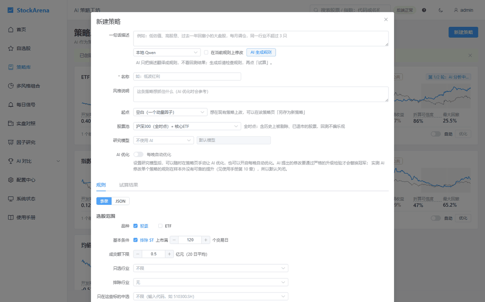
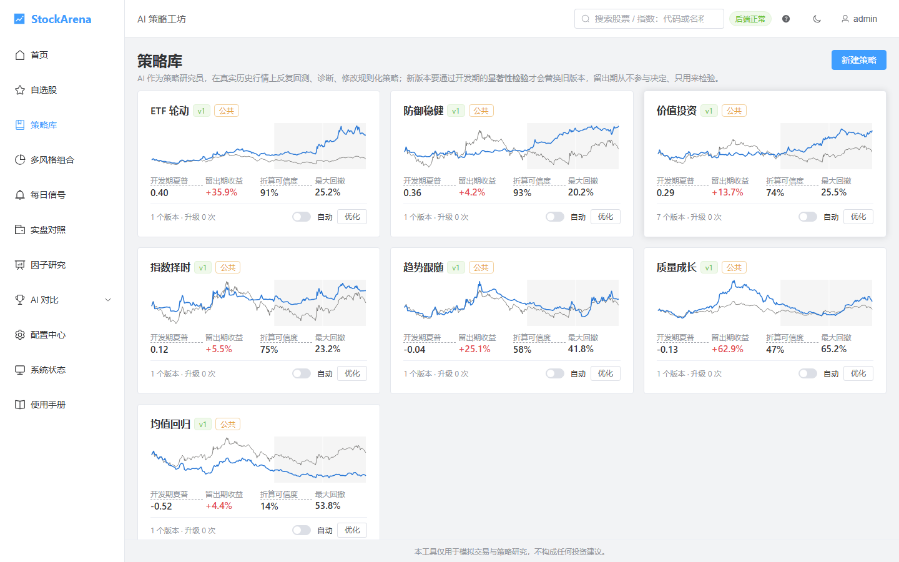
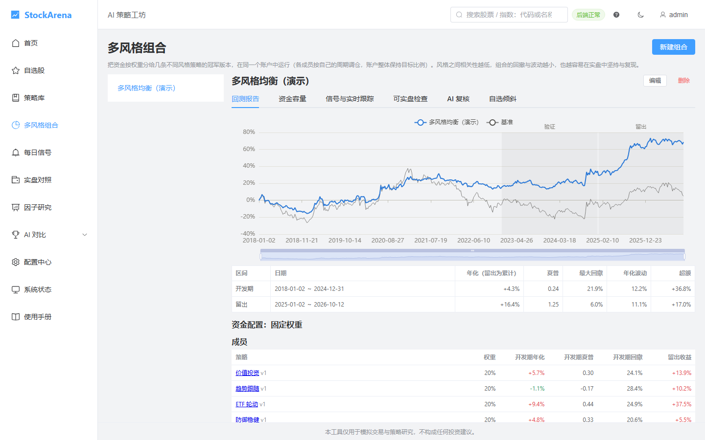
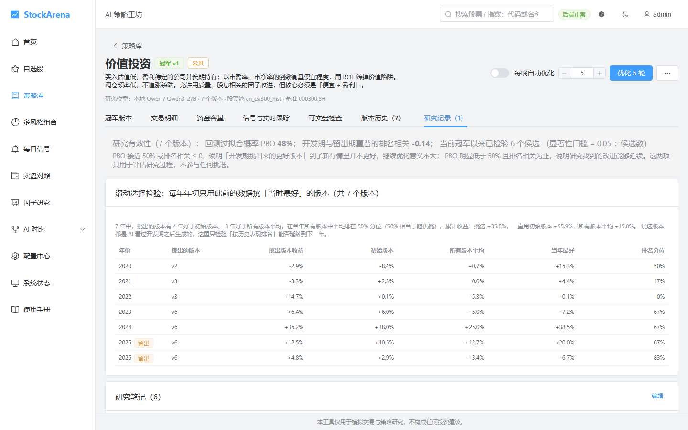
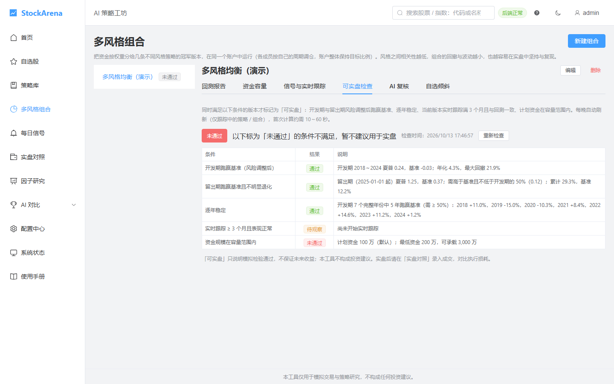

# StockArena · AI 策略工坊

**让 AI 当量化研究员，同时不让它骗自己。**

StockArena 是一个自部署的 A 股量化研究平台：AI（云端或本地大模型）在真实历史行情上反复回测、诊断、修改规则化策略，
程序用一整套防过拟合的检验决定新版本能不能替换旧版本；选中的策略每天给出目标持仓和调仓清单，并在实时模拟账户里持续检验。

> ⚠️ 本项目仅用于学习和策略研究，**不构成任何投资建议**，回测和模拟结果不代表未来收益。使用前请阅读 [免责声明](DISCLAIMER.md)。



| 策略库 | 多风格组合 |
|---|---|
|  |  |
| **AI 优化的研究记录** | **可实盘检查** |
|  |  |

<sub>截图来自一台全新部署的演示实例（快速开始 + 默认策略库，研究模型为本地 Qwen），数字只是示例。</sub>

[English summary](#english-summary)

## 它和其他回测框架有什么不同

- **AI 改策略，程序做裁判**：AI 只能输出 JSON 描述的规则（选股范围、打分因子、过滤条件、持仓数量、权重、调仓周期、止损、择时），
  从 29 个内置因子里选，程序校验后回测，**不执行任何 AI 写的代码**。
- **防过拟合是第一位的**：
  - 开发期 / 留出期分开，**留出期从不参与任何决定**；
  - 新版本要通过逐年对比、月度配对显著性检验（同一轮候选越多门槛越严）、参数扰动稳健性等检验才能升级；
  - 按累计测试次数计算 DSR（紧缩夏普比率）和回测过拟合概率，另存的策略继承测试历史，不能靠复制「洗掉」；
  - 时点股票池（沪深 300 / 中证 800 的历史成分），减少幸存者偏差。
- **从回测走到实盘的每一步都有检查**：资金容量（10 档资金的冲击成本回测）、实时跟踪与回测的一致性、
  「可实盘检查」逐项打分、实盘对照（导入自己的成交，与模拟账户逐笔比较执行损耗）。
- **贴近 A 股实际**：T 日收盘出信号、T+1 开盘成交，考虑整手、一字涨跌停、停牌、佣金（最低 5 元）、过户费、印花税和成交额上限。

## 主要功能

| 功能 | 说明 |
|---|---|
| 策略库 | 7 种风格的公共策略（价值、趋势、均值回归、ETF 轮动、防御、指数择时、质量成长），可查看、另存为自己的策略 |
| 一句话创建策略 | 用中文描述想法，AI 翻译成规则（做不到的条件会逐条列出，不会悄悄丢掉），再用表单检查、试算；试算次数计入测试次数 |
| 新建策略 | 表单式编辑规则并即时试算；可选让 AI 每晚继续优化 |
| AI 优化 | 每一轮：AI 读冠军版本的完整报告和最近的尝试 → 提出候选 → 回测 → 检验 → 达标才升级；每轮研究记录都可查 |
| 多风格组合 | 几条风格不同的策略按权重放进同一账户，分散单一风格的风险 |
| 每日信号与实时跟踪 | 按最新收盘计算目标持仓与调仓清单，模拟账户每天自动交易并与基准对照 |
| AI 交易复核（可选） | 规则账户与 AI 复核账户并行，AI 只能否决新买入，实时比较它是加分还是减分 |
| 自选股监控（可选） | AI 每晚看公告、新闻和异常波动，重要的推送提醒 |
| 优化时间线与体检报告 | AI 每轮改了哪些规则、检验结果、是否采纳；一页汇总表现、过拟合检验和可实盘检查的独立 HTML 报告 |
| 策略导入导出 | 策略存成一个 YAML 文件分享给别人；导入时按自己的数据重新回测，测试历史随文件继承 |
| MCP 接入 | Claude Code、Cursor 等 AI 客户端用个人令牌查询策略、试算、提交新版本（只提供开发期结果） |
| 消息推送 | Server 酱、PushPlus、企业微信群机器人 |
| 多用户 | 数据隔离，AI 模型和交易成本各自配置；开放注册由管理员开关 |
| AI 对比（附带） | 多个 AI 在 A 股 / 港股 / 美股赛道同台模拟交易，含决策回放、自我进化、做空与杠杆 |

AI 模型支持 OpenAI 兼容接口（DeepSeek、通义千问、Kimi、智谱、硅基流动、OpenRouter、Ollama、LM Studio、llama.cpp、vLLM 等）、Anthropic Claude 和 Google Gemini，
API Key 加密保存在你自己的服务器上。**不配模型也能使用**回测、组合、模拟和信号，只是没有 AI 优化与复核。

## 快速开始

需要 Docker 24 以上：

```bash
git clone https://github.com/PandaPanY/stockarena.git stockarena && cd stockarena
docker compose up -d --build
docker compose logs | grep 设置码
```

浏览器打开 `http://服务器地址:18080`，填写首次设置码、设置管理员密码，然后在「策略实验室」点「**快速开始**」：约 4 分钟后就能试算第一个策略，完整数据（约 20～30 分钟）自动在后台继续准备。

不用 Docker、HTTPS 反向代理、备份与升级见 **[部署指南](docs/DEPLOY.md)**。

## 文档

| 文档 | 内容 |
|---|---|
| **[使用手册](docs/USER_GUIDE.md)** | 通俗版：每个页面怎么用、名词解释、常见问题 |
| [部署指南](docs/DEPLOY.md) | Docker / 直接运行、反向代理、备份恢复、升级 |
| [配置参考](docs/CONFIG.md) | 每个配置项和环境变量 |
| [数据源说明](docs/DATA_SOURCES.md) | 每个数据源抓什么、用在哪里、失效时怎么排查 |
| [MCP 接入](docs/MCP.md) | 用 Claude Code、Cursor 等 AI 客户端连接平台 |
| [技能说明](docs/SKILLS.md) | 可选的技能功能：运行要求、隔离方式、风险 |
| [功能说明](docs/FEATURES.md) | 功能细节与实现取舍 |
| [架构](docs/ARCHITECTURE.md) | 程序结构、数据表、定时任务 |
| [需求与决策](docs/PRD.md) | 产品设计与研究记录（含失败的尝试） |

## 数据从哪里来

平台本身不提供、不分发任何数据。运行时由你的部署从第三方公开接口获取：新浪财经、腾讯财经、东方财富、同花顺、巨潮资讯、中证指数、Baostock、港交所等。
这些接口可能随时变化或限流，请遵守各数据源的使用条款，仅用于个人学习研究。详见 [数据源说明](docs/DATA_SOURCES.md)。

## 参与开发

开发环境、提交前检查、代码约定和「研究方法的约定」见 [CONTRIBUTING.md](CONTRIBUTING.md)。安全问题请按 [SECURITY.md](SECURITY.md) 私下报告。更新记录见 [CHANGELOG.md](CHANGELOG.md)。

```
backend/    FastAPI 后端（app/quant 是策略工坊：因子、规则、回测、评估、AI 研究循环、实时跟踪）
frontend/   Vue 3 + TypeScript + Element Plus + ECharts
config/     策略库初始规则、股票池、交易规则集、AI 提示词、配置样例
docs/       文档
scripts/    部署脚本、systemd 模板、容器入口
```

## 许可证

[GNU AGPL-3.0](LICENSE)。你可以自由使用、修改和分发；如果修改后通过网络向他人提供服务，需要向这些用户公开修改后的源代码。第三方声明见 [NOTICE](NOTICE)。

---

## English summary

**StockArena** is a self-hosted quant research platform for China A-shares where an LLM acts as the strategy researcher — and a strict
evaluation pipeline keeps it honest.

- The AI proposes **rule-based strategies as JSON** (universe, factor scoring from 29 built-in factors, filters, position sizing, rebalancing,
  stop-loss, market timing). The platform validates and backtests them; **no AI-written code is ever executed**.
- **Overfitting control comes first**: a development period and a holdout period that never influences any decision; upgrades must pass
  year-by-year comparison, a monthly paired significance test with a multiple-testing-adjusted threshold, and parameter-perturbation robustness;
  Deflated Sharpe Ratio and probability of backtest overfitting are tracked across all trials, and forked strategies inherit their testing history;
  point-in-time index constituents (CSI 300 / CSI 800) reduce survivorship bias.
- Realistic A-share simulation (T+1 open execution, board lots, limit-up/down, suspensions, fees and stamp duty), capacity analysis,
  live paper-trading accounts, daily signals, a readiness checklist before real trading, and reconciliation against your own broker fills.
- Works with any OpenAI-compatible endpoint (DeepSeek, Qwen, Kimi, Ollama, LM Studio, vLLM, …), Anthropic Claude and Google Gemini.
  Usable without any AI model for backtesting, portfolios and signals.
- Strategy health reports (standalone HTML), an optimization timeline, YAML strategy import/export that carries the testing history,
  and a built-in **MCP server** so Claude Code, Cursor and other MCP clients can research strategies with a personal token (development-period
  results only — the holdout stays hidden from automated agents).
- Multi-user with data isolation; one-command Docker deployment.

Data is fetched at runtime by your own deployment from public third-party sources (Sina, Tencent, Eastmoney, CNINFO, CSI, Baostock, …);
the project does not provide or redistribute any market data. The UI and documentation are in Simplified Chinese.

**Not investment advice.** Licensed under [AGPL-3.0](LICENSE). Quick start: `docker compose up -d --build`, then see [docs/DEPLOY.md](docs/DEPLOY.md).
